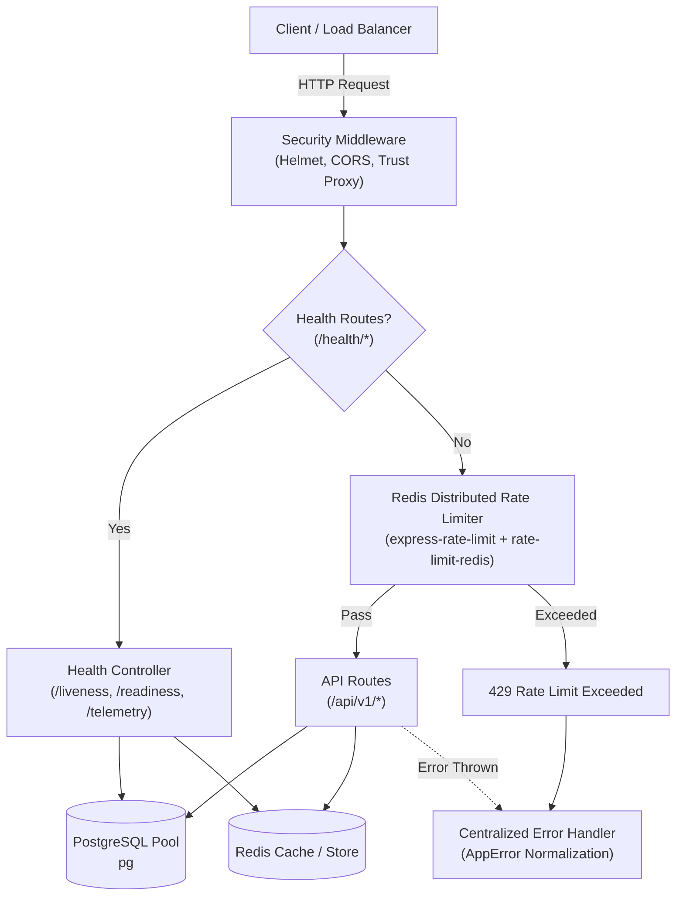
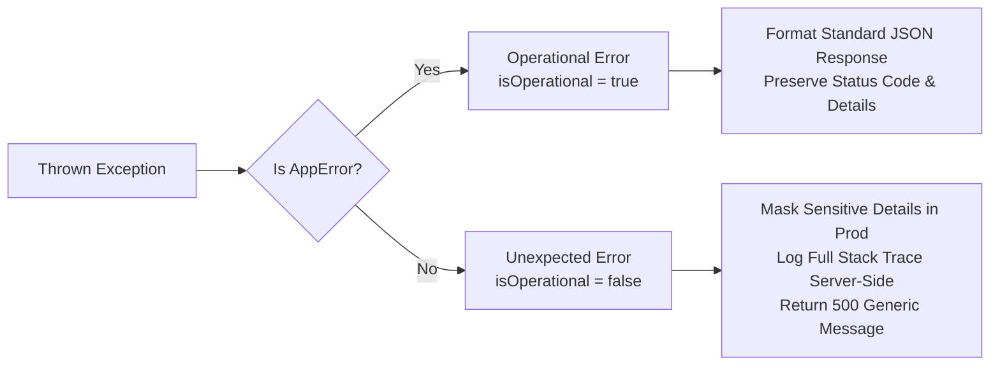

# Resilient Backend Core (`resilient-backend-core`)

[](https://nodejs.org/)
[](https://www.typescriptlang.org/)
[](https://expressjs.com/)
[](https://www.postgresql.org/)
[](https://redis.io/)
[](LICENSE)

A production-ready, resilient Node.js and TypeScript backend architecture designed for high-availability cloud deployments. Features strict type safety, centralized error normalization, Redis-backed distributed rate limiting, PostgreSQL connection pooling, Kubernetes-compatible health probes, and graceful shutdown orchestration.

---

## Architecture Overview



### Architectural Highlights

1. **Defense-in-Depth HTTP Layer**:
   - `helmet` sets hardened HTTP response headers (HSTS, Content Security Policy, X-Frame-Options).
   - `cors` enforces strict origin access policies.
   - Reverse proxy IP trust configuration (`app.set('trust proxy', 1)`) enables precise client IP tracking behind ingress controllers (Traefik, NGINX, Cloudflare).
2. **PostgreSQL Resilient Connection Pool**:
   - Built on `pg.Pool` with connection limits, configurable idle timeouts, connection timeouts, and unhandled idle client error listeners to prevent process termination.
3. **Distributed Rate Limiting**:
   - Uses `rate-limit-redis` for distributed state synchronization across multiple replicas.
   - Configured with `passOnStoreError: true` to fail open, ensuring API availability even during intermittent Redis connectivity hiccups.
4. **Graceful Shutdown & Signal Handling**:
   - Intercepts `SIGTERM` and `SIGINT` from container orchestrators.
   - Halts HTTP listeners to reject new ingress traffic, completes in-flight requests, and drains both PostgreSQL and Redis connections cleanly before process termination.
5. **Observability & Probes**:
   - `/health/liveness`: Verifies Node.js process and event loop viability.
   - `/health/readiness`: Queries PostgreSQL (`SELECT 1`) and pings Redis (`PING`) to ensure readiness before traffic routing.
   - `/health/telemetry`: Exposes heap memory, RSS, uptime, and database pool statistics.

---

## Error Handling Strategy

This boilerplate separates errors into **Operational Errors** and **Programmer Errors**:



### 1. `AppError` Hierarchy
Operational errors inherit from `AppError` ([src/middleware/errorHandler.ts](file:///home/matthew/Desktop/resilient-backend-core/src/middleware/errorHandler.ts)):
- `BadRequestError` (`400 BAD_REQUEST`)
- `UnauthorizedError` (`401 UNAUTHORIZED`)
- `ForbiddenError` (`403 FORBIDDEN`)
- `NotFoundError` (`404 NOT_FOUND`)
- `ConflictError` (`409 CONFLICT`)

### 2. Standardized JSON Error Format

All errors return a predictable schema:

```json
{
  "success": false,
  "error": {
    "code": "RESOURCE_NOT_FOUND",
    "message": "The requested user record could not be found.",
    "details": null,
    "timestamp": "2026-10-11T23:00:00.000Z",
    "path": "/api/v1/users/42"
  }
}
```

In development (`NODE_ENV=development`), the full stack trace is appended to the response for rapid debugging. In production (`NODE_ENV=production`), error messages for unhandled 500 errors are sanitized to prevent internal implementation leaks.

---

## Directory Structure

```text
resilient-backend-core/
├── Dockerfile                         # Multi-stage hardened Alpine build
├── docker-compose.yml                 # PostgreSQL, Redis, and App cluster
├── package.json                       # ESM project dependencies and scripts
├── tsconfig.json                      # Strict NodeNext TypeScript configuration
├── .env.example                       # Environment variables template
├── .gitignore                         # Git exclusion rules
├── README.md                          # Documentation and architecture guide
└── src/
    ├── server.ts                      # Express startup and graceful shutdown
    ├── config/
    │   ├── database.ts                # PostgreSQL connection pool configuration
    │   └── redis.ts                   # Redis client and reconnection policy
    ├── middleware/
    │   ├── errorHandler.ts            # Centralized error handler and AppError
    │   └── rateLimiter.ts             # Redis-backed distributed rate limiter
    └── routes/
        └── health.routes.ts           # Liveness, readiness, and telemetry probes
```

---

## Quickstart

### Option A: Running with Docker Compose (Recommended)

Start the full stack (PostgreSQL 16, Redis 7, and Node.js backend) with healthchecks:

```bash
docker compose up --build -d
```

Check service status and container logs:

```bash
docker compose ps
docker compose logs -f app
```

Tear down the stack and remove persistent volumes:

```bash
docker compose down -v
```

---

### Option B: Local Development

#### 1. Install Dependencies

```bash
npm install
```

#### 2. Configure Environment

Copy the environment template:

```bash
cp .env.example .env
```

Ensure local instances of PostgreSQL and Redis are running (or start just database dependencies using `docker compose up -d postgres redis`).

#### 3. Start Development Server

```bash
npm run dev
```

The server will start at `http://localhost:3000` with hot-reloading powered by `tsx`.

#### 4. Typecheck & Build for Production

```bash
# Typecheck
npm run typecheck

# Build compiled JavaScript to /dist
npm run build

# Start production server
npm start
```

---

## Health & Telemetry Probes

| Endpoint | Method | Purpose | Typical Use Case |
| :--- | :--- | :--- | :--- |
| `/health/liveness` | `GET` | Event loop check | Kubernetes `livenessProbe` |
| `/health/readiness` | `GET` | Upstream DB & Cache check | Kubernetes `readinessProbe` / Ingress |
| `/health/telemetry` | `GET` | Memory, CPU, and connection stats | Observability dashboards & metrics |
| `/api/v1/ping` | `GET` | Baseline API verification | Sanity check |

Test endpoints using `curl`:

```bash
# Liveness probe
curl -i http://localhost:3000/health/liveness

# Readiness probe
curl -i http://localhost:3000/health/readiness

# System telemetry
curl -i http://localhost:3000/health/telemetry

# Sample API endpoint
curl -i http://localhost:3000/api/v1/ping
```
